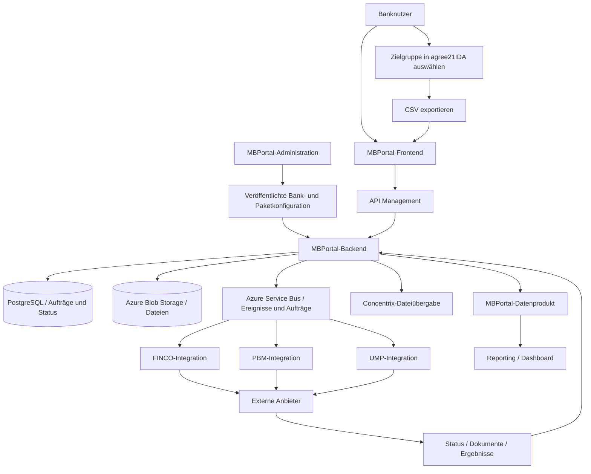
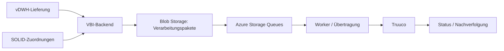

# Marktbearbeitung bei Union Investment

## Warum es die Anwendungen gibt, wie die Leistungen funktionieren und wie die Systeme zusammenspielen

**Gesprächs- und Lernunterlage | Stand: 29. Oktober 2026**  
**Basis:** Die in diesem Chat gelieferten Quellarchive `marktbearbeitung.zip`, `UMP_repos(1).zip`, `tzu(1).7z` und `_2.7z` sowie die bereits daraus erstellten technischen Analysen.  
**Lesedauer:** rund 20 bis 30 Minuten. Für einen schnellen Einstieg erst die Kapitel 1 bis 3 und 13 lesen.

> **Wichtige Einordnung:** Dieses Dokument beschreibt, was die gelieferten Repositories und ihre Dokumentation belegen. Ein enthaltenes Feature ist nicht zwingend in jeder Bank oder Umgebung freigeschaltet. Ein dokumentierter Zielvertrag beweist nicht, dass die Funktion bereits produktiv läuft. Als **Beispiel** gekennzeichnete Szenarien sind erfunden und dienen nur der Erklärung.

---

# 1. Das große Bild in einer Minute

Stell dir eine Volksbank vor, die mehr Kunden zum Thema Sparen beraten möchte. Die Bank kennt ihre Kunden und kann einschätzen, für welche Kundengruppen ein Kontakt interessant sein könnte. Union Investment stellt Fonds- und Anlagelösungen bereit und unterstützt seine Partnerbanken zusätzlich bei der Marktbearbeitung: also dabei, passende Maßnahmen zu planen, auszuführen und ihre Ergebnisse nachvollziehbar zu machen.

**Das MBPortal ist dabei eine Art Auftragszentrale.** Ein Bankmitarbeiter wählt ein Leistungspaket, stellt eine Zielgruppe zusammen, lädt die für diese Maßnahme vorgesehene Kundendatei hoch und bucht den Auftrag. Danach übernehmen je nach Paket andere Systeme die eigentliche Ausführung: etwa Telefonie, Einwilligungsbriefe, digitale Kampagnen oder Rechnerstrecken. Ergebnisse laufen zurück, damit die Bank weiß, was aus dem Auftrag geworden ist. [MB01–MB05]

**Wichtig:** Die Bank lädt nicht ihren gesamten Kundenstamm „zu Union Investment hoch“, um ihn dorthin zu verlagern. Im beschriebenen Buchungsweg übergibt sie eine **für den gewählten Auftrag selektierte CSV-Datei**. Der Upload ist Mittel zum Zweck, nicht das eigentliche Produkt. [MB02]

Die Landschaft hat mehrere fachliche Schwerpunkte:

| Bereich | In einem Satz | Bild im Kopf |
|---|---|---|
| **MBPortal** | Banken beauftragen und verfolgen konkrete Vertriebsmaßnahmen. | **Auftragszentrale** |
| **MBPortal-Administration** | Legt fest, was eine Bank nutzen darf und welche Einstellungen gelten. | **Leitstand / Regelwerk** |
| **UnionMarketingPlattform (UMP)** | Betreibt eigene Marketingprozesse, Materialien, Briefe und Landingpages. | **Marketingwerkstatt** |
| **Investmentwelt** | Bietet Oberflächen, Informationen und Materialien für Marktbearbeitung und Beratung. | **Informations- und Materialportal** |
| **IM Action Hub** | Verwaltet Templates und Impulsaufträge für angebundene Provider. | **Verteiler für Impulse** |
| **Verbundintegration (VBI/VBST)** | Verarbeitet Vertriebsanlässe und Zielgruppen für die Truuco-Welt. | **Daten- und Anlassdrehscheibe** |
| **UBA-Anbindung** | Stellt Rücklieferungsdaten und Dateien bereit. | **Rücklieferungsstelle** |

Das gemeinsame Oberziel ist die Unterstützung von Banken bei Kundenansprache und Beratung. **Nicht jeder Auftrag durchläuft jeden dieser Bereiche.** Einige Systeme sind eigenständige Produkte mit eigenen Prozessen, Technologien und Betriebskonzepten. [SYS01]

---

# 2. Warum arbeiten überhaupt Volksbanken in einer Software von Union Investment?

Die Bank und Union Investment erfüllen **unterschiedliche Rollen im selben Vertriebsumfeld**:

- **Der Privatkunde** hat beispielsweise ein Sparziel oder möchte für sein Kind vorsorgen.
- **Die Volksbank/Raiffeisenbank** kennt und betreut ihre Kunden, wählt eine passende Zielgruppe und verantwortet ihre konkrete Kundenansprache im vorgesehenen Prozess.
- **Union Investment** stellt Anlagelösungen und fachliche Unterstützungsangebote für die Partnerbanken bereit.
- **Die Marktbearbeitungssoftware** organisiert den Weg von der ausgewählten Zielgruppe über den Auftrag bis zu Rückmeldungen und Auswertungen.
- **Angeschlossene Dienstleister und Systeme** übernehmen konkrete Arbeitsschritte, abhängig vom gebuchten Paket.

### Beispiel: „Wir möchten mehr Beratungsgespräche vereinbaren“

Eine fiktive Vertriebsverantwortliche einer Volksbank hat die Idee, eine geeignete Kundengruppe zu einem Spar- oder Anlagegespräch einzuladen. Die Idee allein ist aber noch kein Termin. Sie müsste klären:

1. Welche Kunden passen zur Aktion?
2. Welche Kontaktvoraussetzungen liegen vor?
3. Wer organisiert die Ansprache?
4. Wie wird festgehalten, ob ein Termin zustande kam?
5. Wie gelangt die Rückmeldung zur Bank?

Ein passendes MBPortal-Paket macht daraus einen **strukturierten Auftrag**, statt dass jeder Mitarbeiter einen eigenen Prozess aus E-Mails, Dateien, Telefonlisten und Rückfragen organisiert. Ob die Maßnahme tatsächlich zu Beratungsterminen oder Abschlüssen führt, ist eine eigene fachliche Erfolgsfrage; die Software garantiert keinen Vertriebserfolg. [MB01, MB05]

**Merksatz:** Die Bank bringt den Kundenkontext und die Zielgruppe ein. Union Investment stellt passende Angebote und die Marktbearbeitungsleistung bereit. Die Anwendungen sorgen für die technische Abwicklung.

---

# 3. Wie wählt die Bank Kunden aus?

Die Auswahl erfolgt im dokumentierten Buchungsweg **zunächst außerhalb des MBPortals**, und zwar mithilfe von **agree21IDA** im Atruvia-Umfeld. Das Portal zeigt dafür Hilfstexte und bereitgestellte Selektions-Templates an. [MB02]

## Der Ablauf aus der Benutzeroberfläche

1. **Leistungspaket auswählen:** Die Bank entscheidet sich beispielsweise für Terminvereinbarung oder Leadveredelung.
2. **Selektionsvorlage übernehmen:** Im MBPortal kann der Banknutzer ein für den gewünschten Zweck bereitgestelltes `agree21IDA`-Template kopieren.
3. **Analyse in agree21IDA durchführen:** Die Vorlage wird im vorgesehenen Atruvia-Analysesystem genutzt. Die Bank prüft Felder und Filter und passt die Zielgruppe entsprechend den Anforderungen an.
4. **CSV erzeugen:** Der Bericht wird als CSV-Datei exportiert.
5. **Datei ins MBPortal laden:** Das Portal verarbeitet die ausgewählten Datensätze und ermöglicht die weitere Auftragsbearbeitung.
6. **Auftrag verbindlich buchen:** Nach Prüfung der Paket- und Auftragsbedingungen wird die Durchführung angestoßen.

Die Auswahl ist **keine automatische Übernahme aller Bankkunden**. Sie hängt von der Vorlage und der Entscheidung der Bank ab. Die verfügbaren konkreten Filter sind aus dem mitgelieferten MBPortal-Code nicht vollständig ersichtlich. Man sollte deshalb keine erfundenen Kriterien wie „Kunden ab einem bestimmten Depotvolumen“ als feste Systemregel behaupten. [MB02]

## Was bedeutet `agree21BAP`?

Für das Paket **Terminvereinbarung** gibt es im Frontend einen ausdrücklich dokumentierten Hinweis: Die Muster-Templates sollen Kunden selektieren, bei denen die **Einwilligung zur telefonischen Ansprache in `agree21BAP`** erfasst ist. Das ist eine konkrete Voraussetzung für diesen beschriebenen Weg, keine allgemeine Freigabe für jede Marketingmaßnahme. [MB02]

## Warum CSV und nicht direkt eine automatische Schnittstelle?

**Was sich belegen lässt:** Der untersuchte Portalablauf verwendet einen CSV-Export und Upload. Die Oberfläche validiert insbesondere das Dateiformat; in der untersuchten Upload-Komponente ist zusätzlich eine Dateigrößenbegrenzung für die UI konfiguriert. [MB02]

**Was sich nicht daraus ableiten lässt:** Dass technisch niemals eine direktere Schnittstelle möglich wäre oder dass die CSV fachlich die beste dauerhafte Lösung ist. Die konkrete Architekturentscheidung ist in den vorliegenden Dateien nicht vollständig begründet.

### Datenschutz, verständlich formuliert

Das Hochladen einer Datei ist **keine pauschale Erlaubnis**, beliebige Kunden zu kontaktieren. Für Kontaktkanal, übermittelte Felder, Beteiligte und Zweck müssen die jeweils freigegebenen Fach- und Datenschutzregeln gelten. Gerade bei der Terminvereinbarung ist der Einwilligungshinweis im Selektionsprozess relevant. Aus dem Quellcode allein lässt sich keine rechtliche Vollprüfung ableiten.

---

# 4. Die sechs Leistungspakete des MBPortals

Im Backend sind **genau sechs fachliche Pakete** als `ServicePackage`-Enum enthalten. Zwei Rechnerpakete teilen sich dabei die Administrationsform `LEADVEREDELUNG`. Das sind **sechs Varianten im gelieferten Quellstand**, nicht automatisch sechs überall aktivierte Angebote oder das komplette Produktportfolio von Union Investment. [MB01]

| Paket | Was die Bank beauftragt | Wer/was technisch beteiligt ist | Was zurückkommen kann |
|---|---|---|---|
| **1. Dialogeinwilligung** | Eine adressierte Maßnahme zur Erfassung von Einwilligungen. | MBPortal, `ump-integration`, UMP-Kern, Landingpagetool, Dokumentenablauf. | Kontakt- und Einwilligungsstatus, Nachweise/Dokumente. |
| **2. Terminvereinbarung** | Ansprache einer ausgewählten Zielgruppe mit dem Ziel von Beratungsterminen. | MBPortal und Concentrix-Pfad (im Code historisch auch Webhelp). | Termin gebucht, kein Termin, Kontakt nicht möglich, falsche Rufnummer. |
| **3. Leadveredelung Sparzielrechner** | Kunden über einen Sparzielrechner in eine weiterführende digitale Strecke bringen. | FINCO für Rechner-/Bankflows; PBM für entsprechende Kunden-/Kampagnenimporte; Portal. | Rechner besucht, Sparpotenzial/-ziele ergänzt, Klicks in Folgestrecken. |
| **4. Leadveredelung Elternsparrechner** | Gleiche Grundidee mit dem Anlass Sparen für Kinder. | Eigener Rechnerflow, gemeinsame Leadveredelungs-Administration. | Vergleichbare Nutzungs- und Weiterleitungsereignisse. |
| **5. UnionDigitalSales UDK** | Digitale Maßnahme mit Bezug zu **UnionDepot Komfort**. | PBM-Kampagnen-/Importstrecke, Portal und weitere konfigurationsabhängige Bestandteile. | Beispielsweise E-Mail versendet oder externer Import erfolgreich. |
| **6. UnionDigitalSales JuniorDepot** | Digitale Maßnahme mit Bezug zu **JuniorDepot**. | Vergleichbare DigitalSales-Familie, eigener Paket- und Konfigurationsbezug. | Beispielsweise E-Mail-/Importstatus. |

Die Paketstruktur ist im Quellcode belegt. Die nachfolgenden Alltagsszenen sind **Veranschaulichungen**, keine echten Bankaufträge. [MB01, MB06–MB08]

## 4.1 Dialogeinwilligung: Ein Brief, eine Landingpage, eine bestätigte Einwilligung

**Beispiel:** Eine Bank möchte ausgewählten Kunden eine Möglichkeit anbieten, ihre Kontaktangaben und Einwilligung für weitere digitale Ansprache zu bestätigen.

Der dokumentierte UMP-Prozess ist deutlich mehr als „eine E-Mail schicken“:

1. Das MBPortal beauftragt eine entsprechende Mailingmaßnahme.
2. Die UMP verarbeitet Adressen und Auftrag, erstellt beziehungsweise verwaltet auch Vorschauen.
3. Für Empfänger entstehen individuelle Landingpages.
4. Ein **physischer Brief** führt zur jeweiligen Landingpage.
5. Dort bestätigt der Empfänger seine E-Mail-Adresse und gegebenenfalls Telefonnummer.
6. Das Landingpagetool (**LPT**) meldet die Angaben an die UMP zurück.
7. Die UMP stößt einen **Double-Opt-in-(DOI-)E-Mailprozess** an.
8. Bestätigte Einwilligungen können über die UMP-REST-Schnittstelle für das MBPortal abgefragt werden.

**Das ist die eigentliche Leistung:** eine nachverfolgbare Einwilligungsmaßnahme mit mehreren Kommunikationsschritten und Rückmeldung, nicht nur ein Briefversand. Der dokumentierte technische Ablauf ist kein Nachweis, dass jede denkbare Einwilligung rechtlich wirksam oder jeder Adressat erfolgreich erreicht wurde. [UMP01, MB08]

**Technischer Blick:** MBPortal und UMP sind zwei Anwendungen. Der eigene Adapter `ump-integration` kapselt die Kommunikation zum UMP-System. Die UMP enthält ihrerseits weitere Komponenten, etwa Landingpagetool und Worker. Eine Störung lässt sich deshalb in mehrere Abschnitte eingrenzen: Auftrag, Adressimport, Brief-/Landingpage-Erzeugung, DOI und Rücklieferung.

## 4.2 Terminvereinbarung: Aus einer Kundenauswahl soll ein Gesprächstermin werden

**Beispiel:** Ein Bankmitarbeiter möchte für eine ausgewählte Kundengruppe Beratungstermine organisieren lassen.

Die Bank selektiert geeignete Kunden und prüft die vorgesehenen Telefonieeinwilligungen. Nach dem CSV-Upload und der Buchung verarbeitet das Portal den Auftrag. Im untersuchten Sender erzeugt der Backend-Dienst eine **CSV für Concentrix**, legt sie in **Azure Blob Storage** ab und aktualisiert die Datenstatus. Ein direkter HTTP-Auftragsaufruf an Concentrix ist in dieser Senderklasse **nicht** zu sehen. [MB05]

Die Rückmeldefälle sind im Paketmodell konkret vorgesehen: **Termin gebucht**, **kein Termin gebucht**, **Kontakt nicht möglich** oder **falsche Rufnummer**. [MB01]

Wichtig für ein Gespräch: Ein gebuchter Termin ist noch kein Abschluss, eine erfolgreich abgelegte CSV noch kein bestätigter Telefonkontakt. Dateiübergabe und Bearbeitungsergebnis sind verschiedene Zustände.

## 4.3 Leadveredelung Sparzielrechner: Ein Interesse sichtbar machen

**Beispiel:** Eine Kundin interessiert sich fürs Sparen, weiß aber noch nicht, welches Ziel oder welche Sparrate für sie passt. Ein Rechner kann den Einstieg erleichtern.

Für das Paket sind unter anderem diese Ereignisse vorgesehen:

- erster Rechnerbesuch,
- Sparpotenzial hinzugefügt,
- Sparziel hinzugefügt,
- Klick in Richtung Terminvereinbarung,
- Klick in Richtung **MeinInvest**.

Hier erklärt sich auch, warum ihr **zwei verschiedene Integrationen** habt: **FINCO** richtet bankbezogene Rechner-/Mandantenflows ein. **PBM** kümmert sich um passende Kampagnen- und Kundenimporte samt Status. Diese Aufgaben sind nicht austauschbar. [MB01, MB06, MB07]

**Die Leistung:** Eine digitale Strecke kann helfen, aus einer allgemeinen Ansprache ein konkreter erkennbares Interesse zu machen. Rechnerbesuch oder Klick ist **kein** Nachweis einer tatsächlichen Beratung oder Depoteröffnung.

## 4.4 Leadveredelung Elternsparrechner: Sparen für Kinder als Anlass

**Beispiel:** Statt das abstrakte Thema Geldanlage in den Vordergrund zu stellen, geht es um ein Ziel wie die finanzielle Zukunft eines Kindes.

Technisch ist es eine eigene Paketvariante mit eigenem Rechnerbezug. Die **Konfigurationsfamilie `LEADVEREDELUNG`** und wesentliche Statusarten werden mit dem Sparzielrechner geteilt. [MB01]

**Die Leistung:** Ein anderer fachlicher Einstieg, ohne dafür die komplette technische Verarbeitung neu erfinden zu müssen.

## 4.5 UnionDigitalSales UDK: Digitale Ansprache für UnionDepot Komfort

UDK ist in dieser Paketfamilie der Bezug zu **UnionDepot Komfort**. Im Backend gehören unter anderem `PBM_EMAIL_SENT` und `EXTERNAL_IMPORT_SUCCESS` zu den Statusarten für das Paket. [MB01]

**Beispiel:** Die Bank beauftragt eine für dieses Produkt vorgesehene digitale Maßnahme. Statt selbst die komplette Kampagnenverarbeitung zu organisieren, nutzt sie die angebundene Strecke und kann entsprechende Verarbeitungsstände erhalten.

**Nicht verwechseln:** Eine versandte E-Mail oder ein erfolgreicher Import ist keine bestätigte Depoteröffnung. Im Enum steht zudem ein TODO zur künftigen fachlichen Statusfestlegung, deshalb sollten Statusdetails nicht weiter interpretiert werden, als der Code sie definiert. [MB01]

## 4.6 UnionDigitalSales JuniorDepot: Eigener Produktanlass, ähnlicher Kanal

Dieses Paket greift **JuniorDepot** auf. Es gehört zur gleichen DigitalSales-Familie wie UDK, hat aber eine eigene Paket-/Administrationszuordnung. [MB01]

**Die Leistung:** Standardisierte Verarbeitung für eine andere Produkt- und Zielgruppenansprache, ohne beide Paketvarianten fachlich gleichzusetzen.

## 4.7 Eine interessante technische Kleinigkeit: Starttermine unterscheiden sich

Das Paketmodell definiert nicht nur Namen und Status, sondern auch, wie Starttermine angeboten werden:

| Pakete | Im Enum angelegter Startdatumsmodus |
|---|---|
| Dialogeinwilligung | Berechnung aus UMP-Stopterminen |
| Terminvereinbarung | Monatliche Auswahl |
| Leadveredelung (beide Rechner) | Tägliche Auswahl |
| DigitalSales (beide Pakete) | Wöchentliche Auswahl |

Das ist ein Beispiel dafür, dass die Pakete **nicht bloß unterschiedliche Oberflächentexte** sind. Sie haben jeweils eigene Prozessregeln. Konkrete verfügbare Termine können zusätzlich von Konfiguration und Kapazitäten abhängen. [MB01]

---

# 5. So funktioniert ein MBPortal-Auftrag von Anfang bis Ende

Der folgende Ablauf beschreibt die **gemeinsame Grundmechanik**. Je nach Paket gibt es unterschiedliche Detailpfade.



*Vereinfachtes Funktionsbild. Es behauptet nicht, dass alle gezeichneten Pfeile ausschließlich und immer über Service Bus laufen. Tatsächlich existieren zusätzlich REST-Aufrufe, Timer/Jobs und Blob-Dateiübergaben. Die konkreten Pfade unterscheiden sich pro Paket.* [MB03–MB09, SYS01]

## Schritt A: Die Bank ist eingerichtet

Damit eine Bank das Portal sinnvoll nutzen kann, müssen mehrere Dinge zusammenpassen:

- technischer Bank-/Mandantenkontext,
- Benutzerrollen und erlaubter Zugriff,
- konfigurierte und freigeschaltete Leistungen,
- Ansprechpartner und weitere Bankdaten,
- Ressourcen/Dateien und gegebenenfalls Anbieterparameter,
- passende Datenschemas und technische Infrastruktur.

Ein einzelner Feature-Schalter ersetzt diese Voraussetzungen nicht. `mbportal-configuration` und die Bankaktivierung ergänzen die **fachliche Administration**. [MB04, MB09, SYS01]

## Schritt B: Einstellungen werden gepflegt und veröffentlicht

Im Admin-Frontend werden beispielsweise Ansprechpartner, Bankinformationen und Paketparameter erfasst. Das Admin-Backend unterscheidet **temporäre Konfiguration** von **veröffentlichter Konfiguration**. Erst die Veröffentlichung gibt Änderungen in definierter Weise für nachgelagerte Abläufe frei; dabei werden Änderungsereignisse erzeugt. [MB04]

**Warum das wichtig ist:** Ein gespeicherter Entwurf ist nicht automatisch die wirksame Regel, nach der ein Providerauftrag verarbeitet wird.

## Schritt C: Die Bank erstellt ihren Auftrag

Das Portal führt durch Paketauswahl, Zielgruppen-/CSV-Upload, Prüfung der Datensätze und Buchung. Entwürfe können weiterbearbeitet werden. Bei der verbindlichen Buchung werden Auftragsdaten und Status aktualisiert. Es gibt Prüfungen für Paketverfügbarkeit und Starttermin. [MB02–MB03]

Im Backend existieren eigene Statusmodelle für **Aufträge**, **Personendaten** und **Providerimporte**. Ein erfolgreicher Datenimport ist daher nicht mit einer abgeschlossenen Maßnahme gleichzusetzen. [MB01, MB03]

## Schritt D: Die eigentliche Ausführung läuft an

Das Backend startet für das gebuchte Paket einen passenden Handler. Der Code unterscheidet Paketarten und kann auch Teilaufträge behandeln; beim Start wird der Auftrag unter anderem auf **`IN_AUSFUEHRUNG`** gesetzt. [MB03]

Je nach Paket folgt eine Nachricht im Service Bus, ein REST-Aufruf über einen Adapter oder eine Dateiübergabe. Diese Trennung ermöglicht es, dass ein langsamer externer Dienst nicht immer den ursprünglichen Browseraufruf blockiert.

## Schritt E: Rückmeldungen und Ergebnisse werden zugeordnet

Externe Systeme liefern Ergebnisdaten mit ihren eigenen Kennungen und Statusbegriffen zurück. Das MBPortal muss sie dem **richtigen Auftrag, der richtigen Bank und den richtigen Personen** zuordnen. Andernfalls könnte im Frontend ein falscher oder unvollständiger Stand angezeigt werden. [MB01, MB03]

Einige wichtige technische Muster:

- **Asynchrone Verarbeitung:** Auftrag wurde angenommen, heißt nicht, dass die gesamte Ausführung beendet ist.
- **Outbox:** Ereignisse werden so gespeichert, dass ein Datenbank-Commit und der spätere Nachrichtenversand nachvollziehbar zusammenarbeiten können.
- **Retry/Wiederanlauf:** Vorübergehende Fehler benötigen definierte Wiederholungswege. Doppelzustellungen müssen fachlich beherrscht werden.
- **Audit:** Kritische Änderungen und Vorgänge müssen nachvollziehbar bleiben.

Die Verwendung einer Outbox ist keine Garantie dafür, dass jeder einzelne externe Schritt automatisch genau einmal erfolgt. [MB09, SYS01]

## Schritt F: Auswertung und Nachweise

Das `mbportal-datenprodukt` sammelt historische Kennzahlen und Rechnungsereignisse aus den operativen Abläufen. Das `mbportal-dashboard` ergänzt Reports. **Dashboard, Datenprodukt und Buchungsoberfläche sind unterschiedliche Komponenten.** [MB10, SYS01]

Damit kann eine Bank beziehungsweise der zuständige Fachbereich einen Auftrag und seine Ergebnisse nachvollziehen. Welche Kennzahlen produktiv angezeigt werden und wie sie fachlich definiert sind, erfordert den konkreten Reportstand.

---

# 6. Die wichtigsten MBPortal-Repositories: Wer macht was?

Für das Gespräch lohnt es sich, die Namen in **fachliche Rollen** zu übersetzen:

| Repository | Rolle | Erklärung ohne Quellcodejargon |
|---|---|---|
| `mbportal-frontend` | Bankoberfläche | Hier wählt der Banknutzer ein Paket, lädt eine Zielgruppe hoch und sieht Aufträge und Ergebnisse. |
| `mbportal-backend` | Operativer Kern | Verwaltet Aufträge, Kundendatensätze, Status, Kapazitäten, Dokumente und Kosten. |
| `mbportal-administration-frontend` | Verwaltungsoberfläche | Hier werden bankbezogene Angaben und Paketkonfigurationen gepflegt. |
| `mbportal-administration-backend` | Regel- und Veröffentlichungslogik | Prüft, speichert und veröffentlicht die Konfiguration; informiert nachgelagerte Dienste. |
| `finco-integration` | Rechneradapter | Richtet Bank-/Rechnerflows bei FINCO ein und pflegt sie. |
| `pbm-integration` | Kampagnenadapter | Übergibt Kunden für bestimmte Kampagnen/Importe an PBM und verfolgt deren Verarbeitung. |
| `ump-integration` | Marketingadapter | Kapselt die bestehende REST-Kommunikation zur UMP für Aufträge, Vorschauen und Ergebnisse. |
| `mbportal-datenprodukt` | Auswertung | Aggregiert historische Daten, Kennzahlen und Rechnungsereignisse. |
| `mbportal-dashboard` | Reportingoberfläche | Zeigt Auswertungen; ist **nicht** das Formular zur Paketbuchung. |
| `mbportal-shared` | Gemeinsame technische Basis | Enthält wiederverwendbare Module, etwa Authentifizierung, Messaging und Outbox. |
| `mbportal-configuration` | Technische Konfiguration | Stellt bank- und umgebungsabhängige Konfigurationsdaten bereit. |
| `ui-mb-infrastructure` | Cloud-Betrieb | Beschreibt die Azure-Ressourcen mit Terraform/Terragrunt für DEV, TEST und PROD. |
| `bank-activation` | Bankaktivierung | Ergänzt die technische Einrichtung beziehungsweise Aktivierung einer Bank. |

**Wesentliche Trennung:** `mbportal-configuration` und die Admin-Anwendung sind nicht dasselbe. Das eine liefert **technische Konfigurationswerte**, das andere verwaltet **fachliche Bank- und Paketdaten**. [MB04, MB09, SYS01]

### Was passiert mit API Management?

Das **API Management (APIM)** liegt vor veröffentlichten REST-Schnittstellen und übernimmt Aufgaben wie API-Veröffentlichung, Routing und Richtlinien. Die vielen `web-marktbearbeitung-...-api`-Repositories sind vor allem **Vertrags-/Gateway-Konfigurationen**, nicht zusätzliche vollwertige Backends. Deshalb bedeutet „19 API-Repositories“ nicht „19 weitere Business-Anwendungen“. [SYS01]

---

# 7. UnionMarketingPlattform: Warum hat die UMP so viele Repositories?

Die UMP ist **eine eigene Marketinglandschaft**. Der Begriff „UMP-Legacy“ bezeichnet die Herkunft beziehungsweise technische Generation der gelieferten Projekte, **nicht automatisch eine abgeschaltete Plattform**. Das Archiv enthält 25 UMP-Projektordner, darunter Anwendungen, Bibliotheken, Infrastruktur und Deploymenttools. [UMP01–UMP04, SYS01]

## Die UMP-Fachanwendungen

| Komponente | Was sie beiträgt | Verhältnis zu anderen Systemen |
|---|---|---|
| `unioninvestment` | UMP-Kernanwendung mit Marketing-/Bestellfunktionen und MBPortal-Permission-Orders-API. | Zentraler fachlicher UMP-Prozess; nimmt über den vorgesehenen Adapter Aufträge an. |
| `ui-landingpagetool` | Landingpages für Bankkunden und Übermittlung von Eingaben an UMP. | Besonders anschaulich im Einwilligungsprozess. |
| `ui-producthub` | API für Materialien und Pakete. | Inhalte für weitere Oberflächen, unter anderem über Investmentwelt-Verträge. |
| `ui-reportinghub` | Reporting-/Dashboardwerte für UMP. | Nicht mit `mbportal-datenprodukt` gleichsetzen. |
| `ui-films` | Erzeugt personalisierte Filme. | Eigenständiger Medien-/Verarbeitungsdienst. |
| `file2image` | Erzeugt Bilder und Vorschauen aus Dateien. | Hilfsdienst für Medien- und Dokumentenverarbeitung. |
| `setup-box` | Verwaltet unter anderem Druck-/Objekt- und Kostenkonfigurationen. | Unterstützendes UMP-Verwaltungssystem. |

**Anschaulich:** Die UMP braucht für ein Mailing nicht nur einen „Senden“-Button. Sie benötigt auch Adressverarbeitung, Vorlagen, individuelle Landingpages, Dateiverarbeitung, Hintergrundjobs und Statusrückmeldungen. Dafür existieren mehrere klar zugeordnete Dienste. [UMP01–UMP04, SYS01]

## Die übrigen UMP-Repositories sind nicht alle weitere Anwendungen

Das Archiv enthält außerdem etwa die Bibliotheken `file2image-connector`, `setup-box-client`, `rechnungstool-connector`, `scp-connector`, `encoding-helper`, `php-dmtx` und `ui-frontend-framework`. Infrastruktur und Auslieferung liegen in `catalog`, `live`, `ansible-ump`, `docker-images`, `ui-ci-templates` und `zero-downtime-deployment`. Daneben gibt es Security-/Test- und Datenwerkzeuge. [SYS01]

**Warum wichtig?** Die Zahl der Git-Repositories lässt keine direkte Aussage über die Zahl laufender Geschäftsanwendungen zu. Ein Dienst kann mehrere Repositories nutzen, und eine Bibliothek ist gar kein selbstständig deployter Dienst.

### Was ist mit der zusätzlichen UMP-Action-Hub-Anbindung?

Die **bestehende MBPortal-UMP-REST-Anbindung** für beispielsweise Dialogeinwilligung und die **geplante UMP-Integration am IM Action Hub** sind **zwei unterschiedliche Wege**. Für letztere stehen vier dedizierte Service-Bus-Queues in einem Schnittstellenvertrag. Die vollständige entsprechende Sender-/Empfängerimplementierung war im gelieferten Action-Hub-Code jedoch nicht nachgewiesen. Diesen Zielzustand nicht als bereits produktiv beschreiben. [SYS01]

---

# 8. Investmentwelt: Nicht das zweite MBPortal

Die **Investmentwelt** bildet einen eigenen Anwendungsbereich für **Marktbearbeitung und Beratungsunterstützung**. Im gelieferten Stand sind dafür unter anderem enthalten:

- `iw-frontend-monorepo`: Eine gemeinsame React-/TypeScript-Oberflächenlandschaft mit wiederverwendbaren UI-/Featuremodulen.
- `iw-bff-api`: **Backend for Frontend**, das Daten für die Oberflächen bündelt und aufbereitet.
- `iw-dms-api`: Dokumentenservice für Dateimetadaten und Zugriffe, etwa über zeitlich begrenzte SAS-Links.
- `ui-producthub`: Ein weiterer, von den Investmentwelt-Schnittstellen verwendeter Dienst für Materialien und Pakete.

Der BFF bündelt andere APIs, damit das Frontend nicht alle Details unterschiedlicher Backend-Dienste selbst zusammensetzen muss. Der DMS kümmert sich um Dokumente und Dateien. [SYS01]

**Abgrenzung:** MBPortal wickelt **konkrete gebuchte Maßnahmen** ab. Investmentwelt ist breiter auf **Oberflächen, Informationen, Materialzugang und Beratung** ausgerichtet. Sie können fachlich verwandt sein, ohne identisch zu sein.

### UBA-Anbindung

Die separate `uba-anbindung` verarbeitet Rücklieferungsdaten, verwendet Azure Table-/Blob-Storage und stellt Daten/Dateien über REST und SAS-URLs bereit. Auch das ist **nicht einfach eine Seite im MBPortal**. [SYS01]

---

# 9. Verbundintegration und VBST: Ein anderer Weg zu Vertriebsanlässen

Die **Verbundintegration** verfolgt einen anderen fachlichen Schwerpunkt als das MBPortal. Sie verarbeitet **Vertriebsanlässe, Zielgruppen und ihren Status**, insbesondere zwischen **vDWH**, **SOLID** und **Truuco**. [SYS01]

Der typische technische Ablauf lässt sich so lesen:



Das VBST-Frontend ist eine Oberfläche zum Pflegen von Anlässen, beispielsweise Anlegen, Ändern, Sperren oder Entsperren. Das Backend verarbeitet die Lieferungen und ihre Weitergabe. [SYS01]

**Wichtige Feinheit:** Der Quellstatus **`ABGEHOLT`** belegt zunächst nur die Übernahme einer Lieferung, **nicht** die vollständige erfolgreiche Verarbeitung beim Empfänger. [SYS01]

### Ist VBI direkt mit dem MBPortal verbunden?

Im untersuchten Anwendungscode wurde **keine direkte REST- oder Queue-Laufzeitkopplung** zwischen dem VBI-Backend und dem MBPortal-Kern nachgewiesen. Beide gehören fachlich zur Marktbearbeitung, sind aber **keine zwangsläufige gemeinsame Verarbeitungskette**. Dass beide Zielgruppen oder Vertriebsanlässe betreffen, reicht nicht als Nachweis einer direkten technischen Schnittstelle. [SYS01]

---

# 10. IM Action Hub: Templates und Impulse statt gewöhnlicher Portalaufträge

Der **IM Action Hub** verwaltet Templates und Aufträge, mit denen Impulse an angebundene Provider gegeben werden können. Er steht zwischen fachlichen Auftraggebern und den vorgesehenen Empfängerstrecken. [SYS01]

Für MBPortal ist ein Pfad im Code vorhanden: Es erzeugt bankbezogene Templates, die der Action Hub anlegen oder aktualisieren kann. Für die zusätzliche UMP-Anbindung sind vier gesonderte Queues dokumentiert, aber die vollständige produktive Umsetzung muss separat nachgewiesen werden. [SYS01]

**Einfach gesagt:** Während das MBPortal beispielsweise eine Terminvereinbarungsmaßnahme beauftragt, ist der Action Hub eher auf die **Verwaltung und Verteilung von Impulsen und zugehörigen Templates** ausgelegt. Es wäre falsch, beide als identische Auftragsverwaltung zu beschreiben.

---

# 11. Warum ist das technisch auf mehrere Anwendungen verteilt?

Nicht jeder Dienst macht dasselbe, und nicht alle sind mit denselben Werkzeugen gebaut:

| Technik | Wofür sie in den gelieferten Repos vorkommt |
|---|---|
| **Angular, React, Vue** | Unterschiedliche Benutzeroberflächen und Frameworks. |
| **Java / Quarkus / Azure Functions** | Portal-Backends, Adapter und weitere Dienste. |
| **PHP / Symfony / Laravel** | Wesentliche Teile der UMP-Landschaft. |
| **PostgreSQL / andere Datenbanken** | Operative, administrative und auswertungsbezogene Persistenz, je nach Dienst. |
| **Azure Service Bus** | Asynchrone MBPortal-/Action-Hub-Nachrichten und Ereignisse. |
| **Azure Blob Storage** | Uploads, Dokumente und Übergabedateien. |
| **Azure Storage Queues / Table Storage** | Unter anderem Verarbeitungspakete der VBI und Status-/Rücklieferungspfade. |
| **App Configuration / Key Vault** | Technische Konfiguration und Secret-/Zertifikatreferenzen. |
| **API Management** | Veröffentlichung und Absicherung von REST-Schnittstellen. |
| **Terraform / Terragrunt** | Bereitstellung der Azure-Infrastruktur. |
| **Azure DevOps / GitLab / Nexus** | Quellcode, Pipelines und Artefakte im bisherigen beziehungsweise geplanten Auslieferungsmodell. |

## Warum nicht einfach eine riesige Anwendung?

Das wäre grundsätzlich technisch möglich, hätte aber Nachteile:

1. **Fachliche Grenzen:** Mailing, Terminvereinbarung, Vertriebsanlass und Dokumentenbereitstellung sind andere Geschäftsprozesse.
2. **Unterschiedliche Weiterentwicklung:** Die Änderung einer Landingpage sollte nicht zwingend die Verbundintegration neu ausliefern müssen.
3. **Berechtigungen:** Ein Dienst braucht nur die Daten und Rechte, die für seine Aufgabe erforderlich sind.
4. **Störungen eingrenzen:** Ein Fehler im Provider-Import sollte sich einem bestimmten Verarbeitungsschritt zuordnen lassen.
5. **Bestehende Systeme und Teams:** Teile der Landschaft sind historisch getrennt entstanden und verwenden eigene Technologien und Betriebsabläufe.

**Der Preis der Trennung:** Mehr Schnittstellen, Authentifizierung, Messaging, Versionierung und Monitoring. Viele Microservices sind also nicht automatisch besser als ein guter modularer Monolith. Für die konkrete Landschaft ist die wichtigste Aufgabe, die Grenzen zu **verstehen und zuverlässig zu betreiben**.

### Wie viele Anwendungen sind es denn wirklich?

In den vier untersuchten ursprünglichen Archiven lagen **84 Projektordner**. Dazu gehören **Duplikate, mehrere Git-Stände, 19 API-Einzel-Repositories, Bibliotheken, Templates und Infrastruktur**. Man kann daraus **nicht seriös „84 produktive Anwendungen“** machen. Für eine belastbare Live-Zahl müssten die tatsächlich betriebenen Dienste und Deployments inventarisiert werden. [SYS01]

---

# 12. Was bedeutet das für Betrieb und GitLab-Migration?

Die technische Verantwortung besteht nicht nur daraus, dass eine Website oder Function erreichbar ist. **Ein echter End-to-End-Test fragt:** Kommt die Zielgruppe an? Wird der Auftrag korrekt gebucht? Erreicht die Nachricht den richtigen Adapter? Verarbeitet der Anbieter sie? Kommt die Rückmeldung wieder zum richtigen Bankauftrag?

## Was du als Betreiber im Blick behalten solltest

| Wenn etwas schiefgeht ... | Wo man nachschaut |
|---|---|
| Bank sieht ein Paket nicht | Bankaktivierung, Rollen, veröffentlichte Admin-Konfiguration und Paketfreigabe. |
| CSV-Upload scheitert | Frontend-Vorgaben, Datei-/Spaltenvalidierung und Backend-Importstatus. |
| Auftrag ist gebucht, aber passiert nichts | Starttermin/Handler, Queue-/Topic-Verarbeitung, Outbox und Providerübergabe. |
| Telefonieergebnisse fehlen | Concentrix-Dateiablage, externe Statusrückmeldungen, Kundenzuordnung. |
| Rechnerstrecke ist falsch konfiguriert | FINCO-Mandant, Bank-/Flow-Zuordnung, veröffentlichte Leadveredelungskonfiguration. |
| PBM-Kampagne hängt | Importauftrag, Statusabfrage, Eventverarbeitung und Wiederanlauf. |
| Einwilligung fehlt | UMP-Auftrag, LPT-/DOI-Schritte, Dokumenten-/REST-Rücklieferung. |
| Bericht passt nicht zum Portal | Datenprodukt, Zeitpunkt der Abholung, Ereignisse, fachliche Kennzahlendefinition. |
| Zielgruppe hängt auf dem Weg zu Truuco | vDWH-Lieferung, SOLID-Zuordnung, Blob-Pakete, Storage Queues, Truuco-Status. |

## Warum ihr nach GitLab migriert, ohne Azure neu zu bauen

Die geplante Migration betrifft vor allem **Quellcodeverwaltung, Builds, Pipelines, Artefaktablage, technische Identitäten und Freigabeprozesse**. Für die MBPortal-Infrastruktur wird der vorhandene **Terraform-/Terragrunt-State zunächst weiterverwendet**. Ein Wechsel von Azure DevOps zu GitLab erfordert für sich genommen **keine Neuerstellung der laufenden Ressourcen**. [INF01]

Die abgestimmte Zielstruktur sieht getrennte Bereiche vor:

```text
GitLab
├── marktbearbeitungsplattform              Anwendungen / Builds
│   └── team-mandalorian / mb-portal         bestehende Teamstruktur
└── marktbearbeitungsplattform-infra         vorgeschlagene separate Infra-Gruppe
    └── ui-mb-infrastructure                 Infrastruktur-Repository
```

**Zielzustand, nicht automatisch bereits angelegt:** Die neue Infra-Gruppe soll getrennt sein. Der eigentliche Deploymentprozess muss die vorhandenen Freigaben für TEST/PROD, Change-Management und unveränderliche Artefakte berücksichtigen. Das Entwicklerteam bearbeitet die Anwendungsmigration, während die Infrastrukturmigration eigenständig geplant ist. [INF01]

---

# 13. Fertiger Sprechtext für dein Gespräch

## In 30 Sekunden

> „Wir unterstützen mit unserer Marktbearbeitungslandschaft die Partnerbanken im Vertrieb und in der Kundenansprache. Die Bank wählt beispielsweise in agree21IDA eine passende Zielgruppe aus und beauftragt über das MBPortal eine konkrete Maßnahme, etwa eine Terminvereinbarung oder Dialogeinwilligung. Je nach Paket übernehmen angebundene Dienste die Ausführung. Ergebnisse fließen ins Portal zurück. Daneben gibt es mit UMP, Investmentwelt, Action Hub und Verbundintegration eigene Systeme für Marketing, Inhalte, Impulse und Vertriebsanlässe.“

## In etwa zwei Minuten

> „Das Spannende an unserer Plattform ist, dass wir nicht nur eine Weboberfläche betreiben. Dahinter steht ein kompletter Geschäftsprozess. Stell dir eine Volksbank vor, die bestimmte Kunden zum Thema Sparen ansprechen möchte. Die Bank kennt diese Kunden und erstellt mithilfe von agree21IDA eine passende Selektion. Im MBPortal lädt sie die Datei hoch und bucht ein Leistungspaket.
>
> Je nach Bedarf kann das eine Terminvereinbarung, eine Einwilligungsmaßnahme, eine Rechnerstrecke oder eine digitale Kampagne sein. Das Backend verwaltet Auftrag, Bankkontext und Status. Danach übernehmen verschiedene Integrationen den nächsten Schritt: FINCO für Rechnerflows, PBM für Kampagnen- und Kundenimporte, UMP für Mailing- und Einwilligungsprozesse. Für die Terminvereinbarung existiert ein Dateipfad zu Concentrix. Ergebnisse und Nachweise kommen in die Anwendung zurück.
>
> Die UMP ist dabei eine größere eigenständige Marketinglandschaft mit Landingpages, Materialien, Medien- und Reportingdiensten. Die Investmentwelt stellt zusätzliche Informations- und Beratungsoberflächen bereit. Die Verbundintegration wiederum kümmert sich um Vertriebsanlässe und Zielgruppen auf dem Weg zu Truuco. Der Action Hub ergänzt Template- und Impulsprozesse.
>
> Die Anwendungen verfolgen also ein gemeinsames übergeordnetes Ziel, aber nicht alle bearbeiten denselben Auftrag. Für Betrieb und Infrastruktur ist wichtig, dass Datenflüsse, Schnittstellen, Berechtigungen und Deployments zuverlässig funktionieren. Bei der GitLab-Migration möchten wir diese fachlichen Prozesse unverändert weiterbetreiben und nur den technischen Auslieferungsweg kontrolliert modernisieren.“

## Drei Sätze, die du dir merken kannst

1. **„Die Bank kennt den Kunden, das MBPortal organisiert den Auftrag, die Integrationen koordinieren die Durchführung.“**
2. **„UMP, Investmentwelt und Verbundintegration sind verwandt, aber nicht einfach drei Namen für dieselbe Anwendung.“**
3. **„Eine erfolgreiche technische Übergabe ist noch kein erfolgreiches fachliches Ergebnis.“**

---

# 14. Antworten auf typische Rückfragen

**Warum brauchen Bankmitarbeiter ein Portal von Union Investment?**  
Weil Union Investment Partnerbanken nicht nur Anlagelösungen, sondern im betrachteten Bereich auch eine standardisierte Durchführung und Nachverfolgung bestimmter Marktbearbeitungsmaßnahmen ermöglicht.

**Wieso werden Kunden als CSV hochgeladen?**  
Der dokumentierte Prozess sieht vor, dass die Bank eine für das gewählte Paket gefilterte Zielgruppe in agree21IDA erstellt und die Daten als CSV an den Auftrag übergibt. Das ist keine automatische Gesamtübertragung des Bankkundenbestands. [MB02]

**Welche Filter gibt es in agree21IDA?**  
Die Oberfläche stellt Template-Hilfen bereit. Ihre konkreten Filterdefinitionen sind im gelieferten Quellstand nicht vollständig ablesbar. Für die Telefonie ist die in agree21BAP hinterlegte Anspracheeinwilligung ausdrücklich genannt. [MB02]

**Verkauft das MBPortal Fonds?**  
Die belegten Hauptfunktionen sind Maßnahmenbuchung, Zielgruppenübernahme, Auftragsabwicklung und Rückmeldungen. Ein Rechnerbesuch oder erfolgreiches Mailing ist kein nachgewiesener Fondsabschluss.

**Ist UMP dasselbe wie `ump-integration`?**  
Nein. `ump-integration` ist der **MBPortal-seitige Adapter**. Die eigentliche UMP ist eine separate Marketinglandschaft mit mehreren Diensten.

**Ist der Action Hub schon komplett mit UMP verbunden?**  
Ein gesonderter Zielvertrag mit vier Queues liegt vor. Die vollständige entsprechende Anwendungskette war in den gelieferten Quellen nicht nachgewiesen. [SYS01]

**Ist Investmentwelt die Oberfläche zum Buchen der sechs Pakete?**  
Nein. Diese Buchungsfunktion liegt im MBPortal. Investmentwelt hat einen anderen Schwerpunkt: Inhalte und Beratungs-/Marktbearbeitungsoberflächen.

**Ist die Verbundintegration technisch direkt im MBPortal eingebaut?**  
Im untersuchten Code wurde keine solche direkte Kopplung nachgewiesen. VBI/VBST verarbeitet einen eigenen Anlass-/Zielgruppenfluss. [SYS01]

**Warum so viele Repositories?**  
Weil darin außer selbstständigen Diensten auch mehrere Frontends, Libraries, Infrastruktur, Gateways, Testwerkzeuge und ältere Stände liegen. 84 Ordner sind nicht 84 aktive Anwendungen. [SYS01]

**Was macht der Terraform-State bei der GitLab-Migration?**  
Er beschreibt die Zuordnung zwischen Terraform-Konfiguration und verwalteten Azure-Ressourcen. Die State-Ablage soll beim Wechsel der Pipelineplattform zunächst erhalten bleiben. [INF01]

**Was kann ich zur Produktivität oder Abschlussquote sagen?**  
Die Quellarchive belegen Prozesse und Statusmodelle, **keine konkreten Zeitersparnisse, Abschlussquoten oder wirtschaftlichen Erfolge**.

---

# 15. Begriffe, kurz erklärt

| Begriff | Bedeutung in diesen Anwendungen |
|---|---|
| **Marktbearbeitung** | Planung und Durchführung von Maßnahmen zur Kundenansprache und Vertriebsunterstützung. |
| **Leistungspaket** | Fachlich vordefinierte, buchbare Maßnahme im MBPortal. |
| **Zielgruppe / Selektion** | Ausgewählte Kunden, für die eine konkrete Maßnahme vorgesehen ist. |
| **agree21IDA** | In der Portaloberfläche genanntes Atruvia-Analysesystem zur Zielgruppenselektion. |
| **agree21BAP** | System, auf dessen Einwilligungsinformation zur Telefonansprache die Terminvereinbarungs-Vorlage ausdrücklich verweist. |
| **Leadveredelung** | Eine Ansprache beziehungsweise Rechnerstrecke macht einen allgemeinen Interessenkontakt fachlich konkreter. |
| **DOI / Double Opt-in** | Mehrstufige Bestätigung, etwa über eine zusätzliche Bestätigungs-E-Mail. |
| **Adapter / Integration** | Technischer Vermittler zwischen zwei Anwendungen und ihren Datenmodellen. |
| **BFF** | Backend for Frontend: bereitet Daten anderer Dienste passend für eine Oberfläche auf. |
| **APIM** | API Management: Gateway und Richtlinien für veröffentlichte APIs. |
| **Service Bus** | Nachrichtensystem für asynchrone Ereignisse und Arbeitsaufträge. |
| **Outbox** | Muster, bei dem ein zu versendendes Ereignis zunächst mit dem fachlichen Zustand gespeichert wird. |
| **Tenant / Bankkontext** | Technische Zuordnung des Zugriffs und der Verarbeitung zur betreffenden Bank. |
| **SAS-URL** | Zeitlich/inhaltlich begrenzter Zugriff auf eine Storage-Ressource. |
| **Terraform / Terragrunt** | Werkzeug zur deklarativen Infrastrukturverwaltung und Orchestrierung von Modulen. |
| **State** | Terraform-Zustandsdaten zur Nachverfolgung verwalteter Ressourcen. |
| **CI/CD** | Automatisiertes Bauen, Testen und Ausliefern von Code beziehungsweise Infrastruktur. |

---

# 16. Quellen und was sie tatsächlich beweisen

Die wichtigen Aussagen lassen sich in den folgenden gelieferten Archivdateien nachprüfen. **Die Kennungen sind Quellhinweise innerhalb dieses Dokuments**, keine Behauptung über einen aktuellen Live-Stand. Das Material basiert auf den ZIP-/7z-Snapshots und früheren Prüfungen daraus. Zugangsdaten, Kundendaten oder produktive Deployments wurden für dieses Dokument nicht abgerufen.

## Direkt herangezogene Originalquellen

- **[MB01] Paketmodell und Statusarten:** `marktbearbeitung.zip` → `marktbearbeitung/mbportal-backend/service/src/main/java/com/ui/b2b/mbportal/backend/core/domain/servicepackage/ServicePackage.java` (insbesondere Enum und Statuslisten).
- **[MB02] Kundenselektion und Upload:** `marktbearbeitung.zip` → `marktbearbeitung/mbportal-frontend/src/app/modules/booking/components/booking-stepper/step2-upload-step/upload-step.component.html` und `upload-step.component.ts` (agree21IDA, agree21BAP, CSV).
- **[MB03] Auftragsbuchung und -start:** `marktbearbeitung.zip` → `marktbearbeitung/mbportal-backend/service/src/main/java/com/ui/b2b/mbportal/backend/core/logic/issueorder/IssueServicePackageOrderBean.java` sowie `StartOrderExecutionBean.java`.
- **[MB04] Entwurf und Veröffentlichung von Konfiguration:** `marktbearbeitung.zip` → `marktbearbeitung/mbportal-administration-backend/service/src/main/java/com/ui/b2b/mbportal/administration_backend/core/logic/ConfigurationBean.java`.
- **[MB05] Concentrix-Dateiübergabe:** `marktbearbeitung.zip` → `marktbearbeitung/mbportal-backend/service/src/main/java/com/ui/b2b/mbportal/backend/core/logic/issueorder/ConcentrixSender.java`.
- **[MB06] FINCO-Funktion:** `marktbearbeitung.zip` → `marktbearbeitung/finco-integration/service/src/main/java/com/ui/b2b/finco_integration/service/logic/FincoTenantBean.java`.
- **[MB07] PBM-Funktion:** `marktbearbeitung.zip` → `marktbearbeitung/pbm-integration/service/src/main/java/com/ui/b2b/pbm_integration/service/client/pbm/PbmClient.java`.
- **[MB08] UMP-Adapter:** `marktbearbeitung.zip` → `marktbearbeitung/ump-integration/README.md` und `marktbearbeitung/ump-integration/service/src/main/resources/openapi_ump.yml`.
- **[MB09] Gemeinsame Grundlagen:** `marktbearbeitung.zip` → `marktbearbeitung/mbportal-shared/README.md`, `marktbearbeitung/mbportal-configuration/README.md` und `marktbearbeitung/mbportal-backend/README.md`.
- **[MB10] Datenprodukt:** `marktbearbeitung.zip` → `marktbearbeitung/mbportal-datenprodukt/service/src/main/java/com/ui/b2b/mbportal/datenprodukt/core/logic/DataCollector.java` und die weiteren Datenprodukt-Dienste.
- **[UMP01] Dokumentierter UMP-Einwilligungsprozess:** `UMP_repos(1).zip` → `UMP_repos/UMP_legacy/unioninvestment/docs/content/mb-portal-api/introduction.md`.
- **[UMP02] Landingpagetool:** `UMP_repos(1).zip` → `UMP_repos/UMP_legacy/ui-landingpagetool/README.md` und `docs/introduction/general-information.md`.
- **[UMP03] Produkt- und Materialdienst:** `UMP_repos(1).zip` → `UMP_repos/UMP_legacy/ui-producthub/README.md`.
- **[UMP04] Reportingdienst:** `UMP_repos(1).zip` → `UMP_repos/UMP_legacy/ui-reportinghub/README.md`.

## Zusammenführungen und weiterführende Lektüre

- **[SYS01]** Das zuvor aus den Quellarchiven erstellte `Marktbearbeitung_Technisches_Gesamthandbuch.pdf`, insbesondere Kapitel 02–09 (Gesamtarchitektur, Repositories, UMP-Legacy, Investmentwelt, VBI, Action Hub, Messaging). Der Bericht ist eine **sekundäre Auswertung der gelieferten Quellen**, keine unabhängige Live-Verifizierung.
- **[INF01]** `marktbearbeitung.zip` → `marktbearbeitung/ui-mb-infrastructure/environment/root.hcl`, die GitLab-Migrationsunterlagen `Zukunftsdesign.html` und `Gitlab Migration_1577e3f0dab04b57bb97152292e8d9b1-271026-0909-2320.pdf`. Letztere beschreiben **Soll-Architektur und Onboarding**, nicht den belegten Fortschritt der Migration.

## Explizit offen

- Die **konkreten Filter** der in der Bank tatsächlich verwendeten agree21IDA-Vorlagen.
- Die **heute aktivierten Leistungspakete und deren bankabhängige Konfiguration** je Umgebung.
- Die tatsächlichen **aktuellen Deployments, Infrastruktur- und Rechtezustände** in Azure/GitLab.
- Die **vollständige Umsetzung** der zusätzlich dokumentierten UMP-Action-Hub-Queue-Anbindung.
- Gemessene **wirtschaftliche Wirkung**, Abschlussquoten und alle vertraglichen/organisatorischen Datenschutzdetails.

**Abschlusssatz:** Die Marktbearbeitungslandschaft ist kein einzelnes Portal und auch keine Sammlung unabhängiger Websites. Sie ist ein Verbund spezialisierter Anwendungen, der für Partnerbanken aus einer Zielgruppenauswahl einen bearbeitbaren Auftrag, eine geregelte Durchführung und nachvollziehbare Ergebnisse machen soll.
